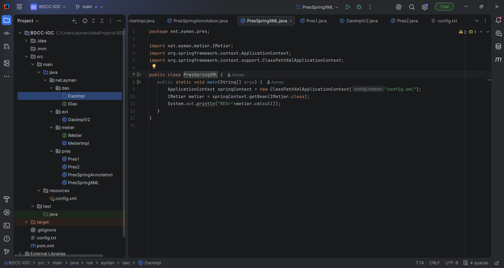
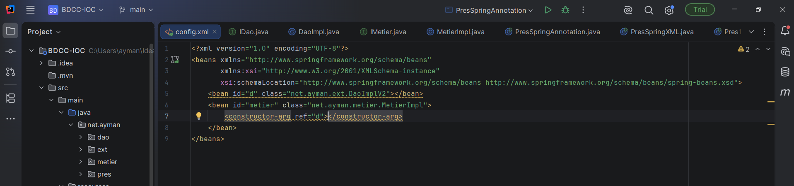

# BDCC-IOC — Dependency Injection with Spring

## 📌 Project Description
This project demonstrates **Inversion of Control (IoC)** and **Dependency Injection (DI)** using Java and the Spring Framework. It shows how dependency injection reduces coupling between classes and makes an application easier to maintain and extend.

## 🎯 Objectives
- Understand the principles of Inversion of Control (IoC)
- Use interfaces to achieve loose coupling
- Separate the data access layer from the business layer
- Explore static and dynamic instantiation
- Configure Spring beans using XML

## 🛠️ Technologies Used
- Java
- Spring Framework
- Maven
- XML
- IntelliJ IDEA

## 📂 Project Structure
```
BDCC-IOC/
├── src/
│   ├── main/
│   │   ├── java/net/ayman/
│   │   │   ├── dao/
│   │   │   ├── ext/
│   │   │   ├── metier/
│   │   │   └── pres/
│   │   └── resources/
│   │       └── config.xml
│   └── test/
├── screenshots/
├── pom.xml
└── README.md
```

## 🧩 Main Components
- **DAO layer**: provides data through the `IDao` interface and its implementation.
- **Business layer**: uses the `IMetier` interface and its implementation to perform calculations with the data from the DAO.
- **Presentation layer (`pres`)**: contains the main classes that run the application.
- **Spring configuration**: `config.xml` declares the beans and injects the dependencies.

## 🚀 How to Run
1. Clone the repository:
```bash
   git clone https://github.com/AymanAsghar/dependency-injection-spring.git
```
2. Open the project in IntelliJ IDEA.
3. Wait for Maven to download the dependencies.
4. Run the main class in the `pres` package.

## 📸 Screenshots

### Project Structure


### Spring Configuration


### Execution Result


## 📚 Learning Outcomes
- Applying IoC and dependency injection principles
- Designing Java applications with interfaces
- Organizing code into separate layers
- Managing dependencies with Maven
- Configuring Spring beans with XML

## 👨‍💻 Author
**Ayman Asghar** — Engineering Student, Cybersecurity

## 📄 License
Developed for educational purposes.
